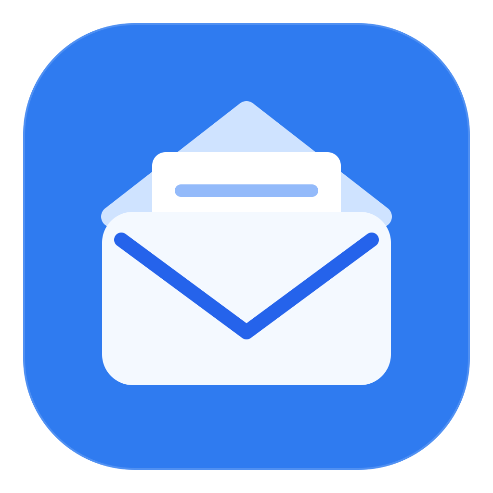
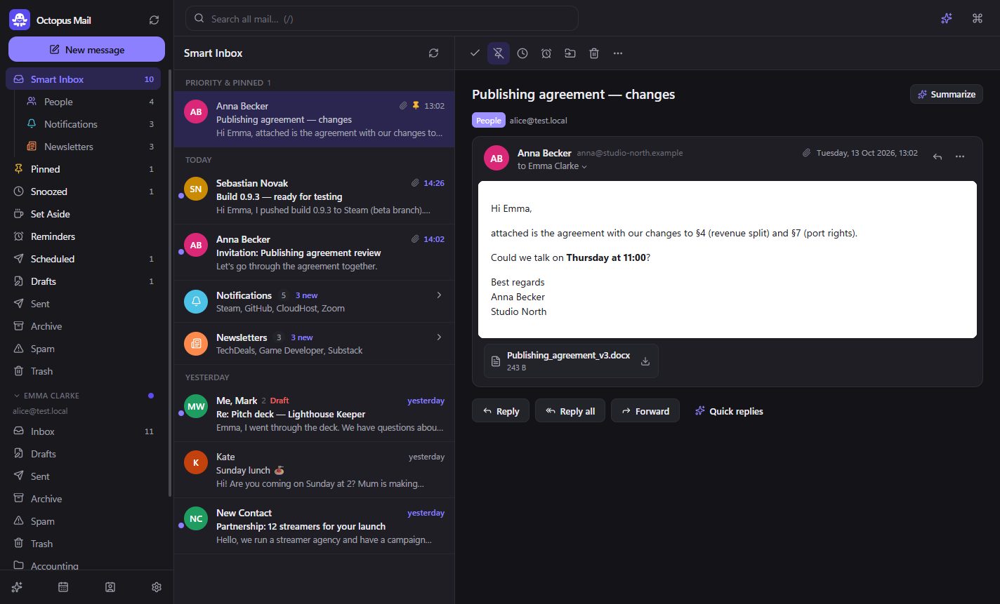
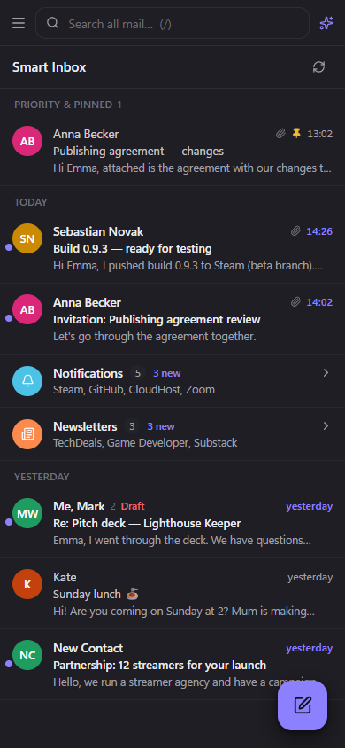
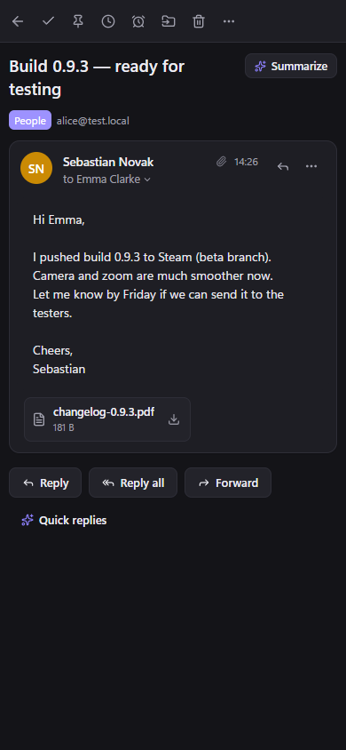
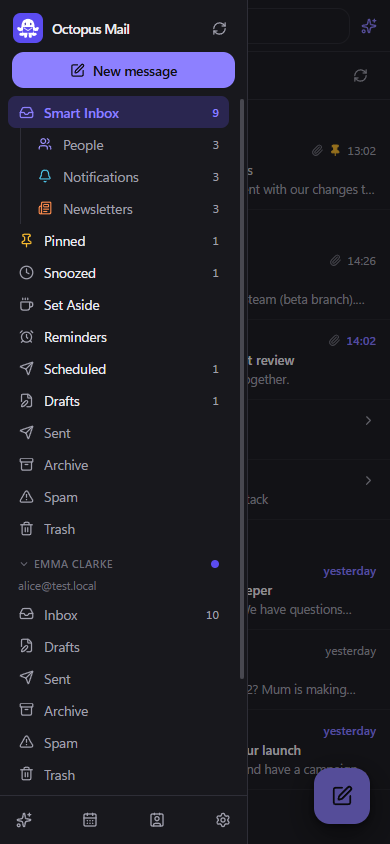
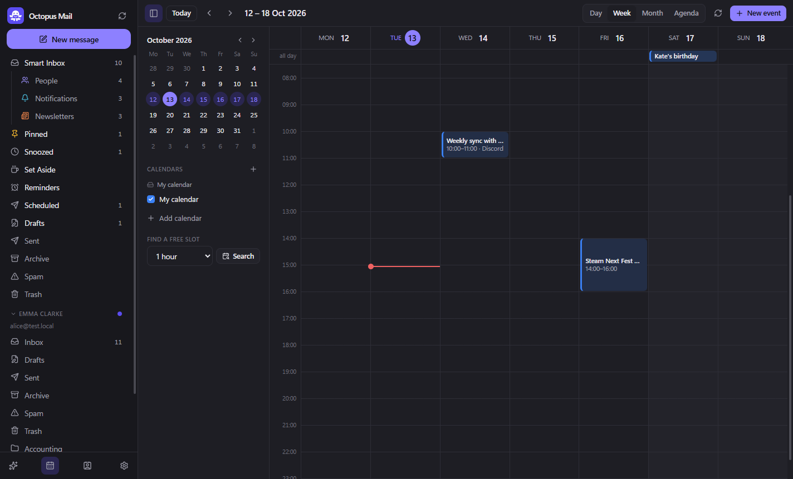

<div align="center">

**English** · [Polski](README_pl.md)



# OpenMail

### A free, local-first email client with a Smart Inbox, AI and your own home server instead of somebody else's cloud.

[](LICENSE)
[](#install)
[](#ai-agents-cli-and-mcp)



</div>

> OpenMail is a fork of [Octopus Mail](https://github.com/CFGPeter/octopus-mail) by Krabi (MIT). Existing profiles keep working: the data folder and keychain entry keep their legacy `Octopus Mail` name.

---

OpenMail brings the comfortable parts of modern mail apps (Smart Inbox, screening new senders,
snooze, send later, follow-up reminders, templates, AI writing help, calendar) to plain IMAP/SMTP
accounts, **without sending your mailbox to a vendor's cloud**. Your mail, passwords and AI data stay
on your computer, or on a small server in your home if you want sync and a phone view.

The app speaks **English and Polish**: it follows your system language, and you can switch it in
*Settings → Appearance & general*.

## Why

Spark is a lovely mail client, but it keeps your accounts and scheduled mail in its cloud, and its
agent CLI only works while the desktop app is running. Octopus Mail, the project OpenMail forks, started as an experiment after the
video *"Every app on Earth is now open source… whether it likes it or not"* about
[REA](https://github.com/morluto/rea): could one person with an AI coding agent
([Claude Code](https://claude.com/claude-code)) rebuild the features they use every day as an open,
local-first app? The answer: a working client in a day. The code, graphics and name are original;
Spark's public feature set was only the to-do list.

## Features

**Mail**
- Many IMAP/SMTP accounts in one inbox: Gmail (app password or OAuth), Outlook / Microsoft 365 (OAuth),
  iCloud, Yahoo, Fastmail, Zoho, GMX, mail.com, Proton Bridge, Polish providers (home.pl, WP, o2,
  Onet, Interia) and any IMAP server. Server settings are discovered automatically.
- Incremental sync, instant new mail through IMAP IDLE, threads (including Gmail threads), Gmail labels.
- **Smart Inbox**: People / Notifications / Newsletters, collapsible group cards, Priority and Pinned.
- **Gatekeeper**: new senders wait for approval; accept or block an address or a whole domain.
- **Done**, pin, **snooze** in natural language, **set aside**, **remind me if nobody replies**, mute,
  one-click **unsubscribe** (RFC 8058), **undo** for every action and **undo send**.
- Rich editor, **templates with fields**, signatures per account, aliases, **send later**,
  drafts synced with the server.
- Full-text search with Gmail-style operators (`from: has:attachment newer_than:7d in: filename:` …),
  accent-insensitive, plus **smart folders**.
- Safe HTML view: remote images and **tracking pixels blocked** until you allow them.
- **Rules** with a dry run on existing mail, **Ctrl+K** command palette, Gmail-style shortcuts,
  light and dark theme, tray icon with unread count.

**AI** (local with [Ollama](https://ollama.com), or Claude with your own API key)
- Thread summaries, reply drafts in your voice, rewrite / shorten / change tone, translate,
  quick replies, write from a prompt, and **ask questions about your whole mailbox** with sources.

**Calendar and contacts**
- Google Calendar, CalDAV (iCloud, Fastmail, Nextcloud), ICS subscriptions and a local calendar;
  day / week / month / agenda, recurring events, invitations with Yes / Maybe / No, **free slots**.
- Address book built from your mail plus Google contacts.

**Home server (instead of a vendor cloud)**
- `octo serve` on an always-on box (Raspberry Pi, NAS, old laptop) sends scheduled mail and wakes
  snoozed mail and reminders while your computers are off.
- Every computer sees the same accounts, snoozes and drafts. Phones and browsers get a web UI with a
  phone layout that you can add to the home screen.
- One owner account on the server (email + password + optional TOTP two-step verification); each device gets its own revocable key. Pairing codes remain for first setup.

**AI agents: CLI and MCP**
- `octo`: a CLI and an **MCP server** for Claude Code / Claude Desktop with per-account access levels
  (read / triage / send). It works **while the app is closed**, uses local time with offsets, keeps
  stable draft IDs, can **cancel a scheduled send** and keeps an action history.

<div align="center">

&nbsp;

&nbsp;

<br /><br />

</div>

## Install

**macOS (Apple Silicon):** download `OpenMail-<version>-arm64.dmg` from
[Releases](https://github.com/ugovb/openspark/releases). The app is not notarized: right-click it, then *Open*.

**Windows:** download `OpenMail-Setup-<version>.exe` from
[Releases](https://github.com/ugovb/openspark/releases). The installer is not code-signed yet,
so Windows SmartScreen shows "Unknown publisher": choose *More info → Run anyway*.

**Linux desktop:** build an AppImage / .deb from source (see below). CI tests every commit on Ubuntu.

**Home server (Raspberry Pi 3/4/5/Zero 2 W with 64-bit Raspberry Pi OS, Debian, Ubuntu):** download
`openmail-server-<version>.tar.gz` from Releases, then on the server:

```bash
tar xzf openmail-server-*.tar.gz && cd openmail-server
sudo bash install.sh
```

The installer puts a private Node.js 24 in `/opt/openmail`, installs the `openmail` systemd
service (starts on boot, restarts after a crash) and the `octo` command, then prints the server address
and a pairing code. Run it again with a newer archive to update; `sudo bash install.sh --uninstall`
removes it and keeps your data.

**Docker** (Synology, QNAP, Unraid…):

```bash
docker compose -f deploy/docker-compose.yml up -d --build
docker compose -f deploy/docker-compose.yml exec octopus octo server pair
```

**Connecting devices:** in the app open *Settings → Home server* and enter the address and code. On a phone, open the server address in the browser and type the code.
Keep the server on your home network and use a VPN such as Tailscale or WireGuard from outside;
see [SECURITY.md](SECURITY.md).

## Build from source

Requires Node.js 24.

```bash
npm install
npm run dev           # app with hot reload
npm run dist          # Windows installer → dist/
npm run dist:linux    # AppImage + .deb (build on Linux)
npm run dist:server   # home server archive → dist/
```

App data: Windows `%APPDATA%\Octopus Mail`, Linux `~/.config/Octopus Mail`. Passwords and tokens go to
the system secret store (Windows Credential Manager, GNOME Keyring / KWallet), never to the database.

## AI agents: CLI and MCP

```bash
octo emails                                   # Smart Inbox
octo search --filter "from:anna newer_than:7d"
octo draft --reply-to 123 --body "Thanks, Friday works for me."
octo send 45 --at "tomorrow 9:00"             # send later ("mon 14:30", "in 3 days", "2026-10-20 9:00")
octo unschedule 45
```

To connect Claude Code, copy the ready-made `claude mcp add …` command from the app
(*Settings → AI agents & CLI*). With a home server, the agent can talk to it over SSH:
`claude mcp add openmail --scope user -- ssh pi@raspberrypi.local octo mcp`.

Each account starts with **read-only** agent access. Only you can raise it, in the app.

## Tests

```bash
npm run greenmail     # local test mail server (Java 17+), keep it running
npm test              # mail engine, home server and calendar
```

Tests and the demo profile (`npm run demo:seed && npm run demo`) never touch real accounts.

## Not there yet

Team features (shared threads, comments), meeting notes, natural-language AI rules and auto-drafts,
integrations (Todoist, Notion…), a home screen with swipe gestures, creating recurring events,
and a native phone app with push notifications. Read receipts / open tracking are left
out on purpose.

## License and trademarks

[MIT](LICENSE). OpenMail is an independent project and is not affiliated with, endorsed by or
connected to Readdle. Spark and other product names are trademarks of their respective owners.
No code, graphics or text from Spark are used.
