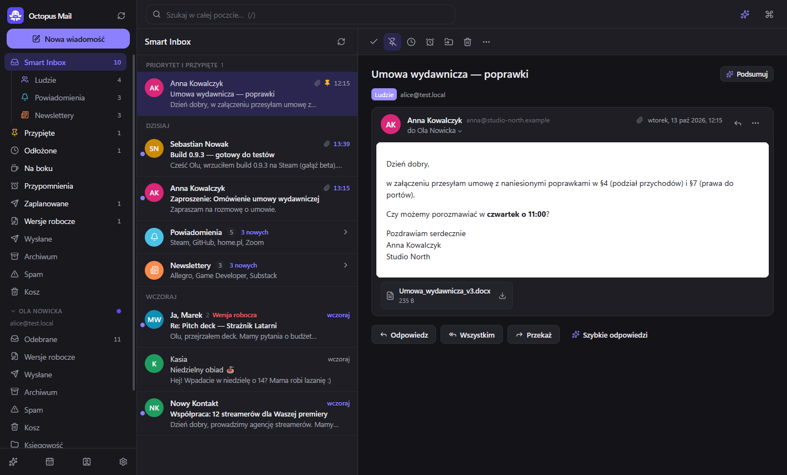
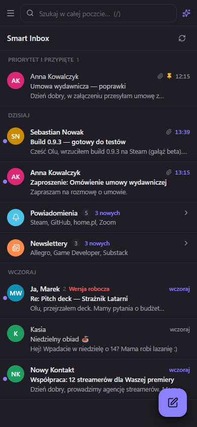
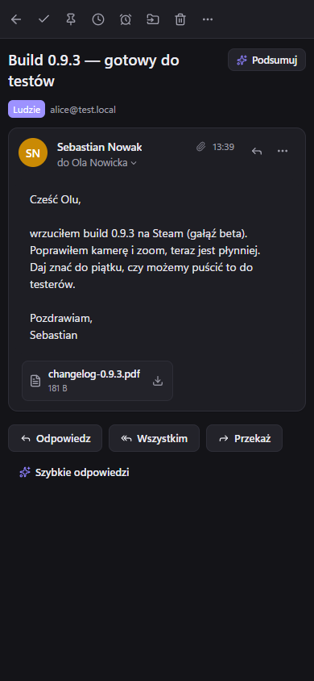
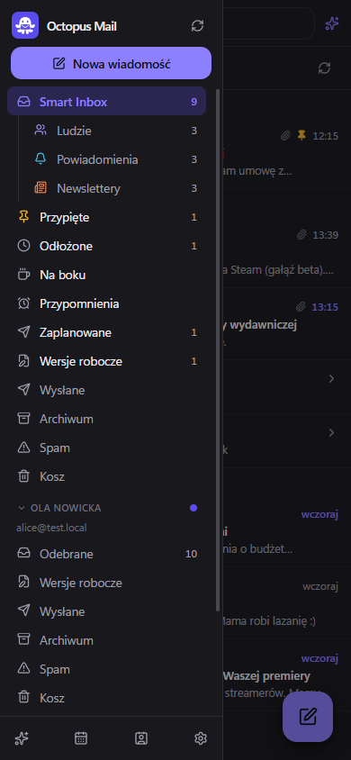

<div align="center">

[English](README.md) · **Polski**


# OpenMail

### Darmowy klient poczty z Smart Inbox, AI i własnym serwerem domowym zamiast cudzej chmury.

[](LICENSE)
[](#instalacja)



</div>

---

OpenMail daje zwykłym kontom IMAP/SMTP to, co najwygodniejsze w nowoczesnych programach pocztowych:
Smart Inbox, sprawdzanie nowych nadawców, odkładanie, wysyłkę zaplanowaną, przypomnienia o braku
odpowiedzi, szablony, pomoc AI i kalendarz. **Bez wysyłania skrzynki do chmury producenta.** Poczta,
hasła i dane AI zostają na Twoim komputerze albo na małym serwerze w Twoim domu.

## Skąd ten projekt

Spark to świetny program, ale trzyma konta i zaplanowane wysyłki w swojej chmurze, a jego CLI dla agentów
działa tylko przy włączonej aplikacji. OpenMail powstał jako eksperyment po filmie *„Every app on
Earth is now open source… whether it likes it or not”* o [REA](https://github.com/morluto/rea): czy jedna
osoba z agentem AI ([Claude Code](https://claude.com/claude-code)) odtworzy funkcje, których używa na co
dzień, jako otwarty program działający lokalnie? Wyszedł działający klient w jeden dzień. Kod, grafika
i nazwa są własne; publiczna lista funkcji Sparka posłużyła tylko jako lista zadań.

## Co działa

**Poczta**
- Wiele kont IMAP/SMTP w jednej skrzynce: Gmail (hasło do aplikacji lub OAuth), Outlook/Microsoft 365
  (OAuth), iCloud, Yahoo, home.pl (wykrywane po rekordzie MX domeny), mail.com, GMX, WP/o2/Onet/Interia,
  Fastmail, Zoho, Proton Bridge i dowolny serwer IMAP. Ustawienia serwera wykrywane automatycznie.
- Synchronizacja przyrostowa, natychmiastowe powiadomienia przez IMAP IDLE, wątki (także wątki Gmaila),
  etykiety Gmaila, starsza poczta doczytywana przy przewijaniu.
- **Smart Inbox**: Ludzie / Powiadomienia / Newslettery, zwijane karty grup, sekcja Priorytet i przypięte.
- **GateKeeper**: nowi nadawcy czekają na akceptację; akceptacja/blokada adresu albo całej domeny.
- **Zrobione**, przypinanie, **odłóż** z językiem naturalnym („jutro 9”, „pt 14:30”, „za 3 dni”),
  **na bok**, **przypomnij, jeśli nikt nie odpowie**, wyciszanie wątków, priorytety, **wypisywanie
  z newsletterów** jednym kliknięciem (RFC 8058).
- **Cofnij** każdą akcję (Ctrl+Z) i **cofnij wysłanie** (0–30 s).
- Edytor z formatowaniem, **szablony z polami** (`{{imię odbiorcy}}`), podpisy per konto, aliasy,
  **wyślij później**, wersje robocze synchronizowane z serwerem.
- Wyszukiwanie pełnotekstowe z operatorami Gmaila (`from: has:attachment newer_than:7d in: filename:` …),
  bez polskich znaków („zolta” znajdzie „żółta”), **inteligentne foldery**.
- Bezpieczny podgląd HTML: blokada zdalnych obrazów i **pikseli śledzących**, zwijane cytaty.
- **Reguły** z testem na istniejącej poczcie, paleta poleceń **Ctrl+K**, skróty klawiszowe, tryb
  jasny/ciemny, ikona w zasobniku z licznikiem.
- Interfejs **po polsku i po angielsku** — według języka systemu albo do wyboru w Ustawieniach.

**AI** (lokalnie przez [Ollamę](https://ollama.com) albo Claude z Twoim kluczem)
- Podsumowanie wątku, odpowiedź w Twoim stylu, poprawianie i zmiana tonu, tłumaczenie, szybkie
  odpowiedzi, „napisz z polecenia”, **pytania do całej poczty** ze źródłami.

**Kalendarz i kontakty**
- Kalendarz Google, CalDAV (iCloud, Fastmail, Nextcloud), subskrypcje ICS, kalendarz lokalny; widoki
  dzień/tydzień/miesiąc/agenda, wydarzenia cykliczne, zaproszenia Tak/Może/Nie, **wolne terminy**.
- Książka adresowa budowana z korespondencji + kontakty Google.

**Serwer domowy (zamiast chmury)**
- `openmail serve` na stale włączonym komputerze (Raspberry Pi, NAS, stary laptop) wysyła zaplanowane
  wiadomości, budzi odłożone i przypomnienia, kiedy Twoje komputery są wyłączone.
- Wszystkie komputery widzą te same konta, odłożone i wersje robocze. Telefon i przeglądarka dostają
  interfejs WWW z układem na telefon (można go dodać do ekranu głównego).
- Urządzenia łączysz jednorazowym kodem; każde dostaje własny klucz, który możesz odebrać.

**Agenci AI (CLI i MCP)**
- `openmail`: CLI i serwer **MCP** dla Claude Code / Claude Desktop z poziomami dostępu per konto (odczyt /
  porządkowanie / wysyłka). Działa **przy zamkniętej aplikacji**, podaje czas lokalny z przesunięciem,
  ma stałe ID wersji roboczych, **anulowanie zaplanowanej wysyłki** (`openmail unschedule`) i dziennik działań.

<div align="center">

&nbsp;

&nbsp;

</div>

## Instalacja

**Windows:** pobierz `OpenMail-Setup-<wersja>.exe` z
[Releases](https://github.com/ugovb/openspark/releases). Instalator nie jest jeszcze podpisany,
więc Windows pokaże „Nieznany wydawca”: wybierz *Więcej informacji → Uruchom mimo to*.

**Linux (aplikacja):** zbuduj AppImage / .deb ze źródeł (niżej). Każda zmiana jest testowana na Ubuntu.

**Serwer domowy (Raspberry Pi 3/4/5/Zero 2 W z 64-bitowym Raspberry Pi OS, Debian, Ubuntu):** pobierz
`openmail-server-<wersja>.tar.gz` z Releases i na serwerze:

```bash
tar xzf openmail-server-*.tar.gz && cd openmail-server
sudo bash install.sh
```

Instalator pobiera Node.js 24 do `/opt/openmail` (systemowego Node nie rusza), instaluje usługę
systemd `openmail` (startuje z systemem, wstaje po awarii) i polecenie `openmail`, a na końcu wypisuje
adres serwera i kod parowania. Aktualizacja: to samo z nowym archiwum. Odinstalowanie:
`sudo bash install.sh --uninstall` (konta i poczta zostają).

**Docker** (Synology, QNAP, Unraid…):

```bash
docker compose -f deploy/docker-compose.yml up -d --build
docker compose -f deploy/docker-compose.yml exec octopus openmail server pair
```

**Podłączanie urządzeń**
- Komputer: Ustawienia → **Serwer domowy** → adres serwera + kod. Aplikacja uruchamia się ponownie
  i korzysta z kont na serwerze.
- Telefon / przeglądarka: otwórz adres serwera i wpisz kod.
- Kolejny kod: `openmail server pair` na serwerze albo Ustawienia → Serwer domowy → **Dodaj urządzenie**.
- Serwer trzymaj w sieci domowej, a spoza domu łącz się przez VPN (np. Tailscale, WireGuard), nie przez
  przekierowanie portu w routerze. Szczegóły: [SECURITY.md](SECURITY.md).

## Budowanie ze źródeł

Wymaga Node.js 24.

```bash
npm install
npm run dev           # tryb deweloperski z przeładowaniem
npm run dist          # instalator Windows → dist/
npm run dist:linux    # AppImage + .deb (budować na Linuksie)
npm run dist:server   # archiwum serwera domowego → dist/
npm run icon          # ikony z resources/brand/*.svg (pip install -r scripts/requirements-brand.txt)
```

Dane programu: Windows `%APPDATA%\Octopus Mail`, Linux `~/.config/Octopus Mail`. Hasła i tokeny trafiają
do systemowego magazynu haseł (Menedżer poświadczeń Windows, GNOME Keyring / KWallet), nigdy do bazy.

Antywirusy przechwytujące pocztę (np. Kaspersky) podmieniają certyfikaty serwerów — OpenMail ufa
certyfikatom systemu, więc działa z nimi tak jak Outlook.

## CLI i MCP

```bash
openmail emails                                   # Smart Inbox
openmail search --filter "from:anna newer_than:7d"
openmail draft --reply-to 123 --body "Dzięki, pasuje mi piątek."
openmail send 45 --at "jutro 9:00"                # wysyłka zaplanowana
openmail unschedule 45                            # anulowanie
openmail action snooze t12 --until "pon 8:00"
```

Gotowe polecenie `claude mcp add …` do Claude Code jest w aplikacji: Ustawienia → Agenci AI i CLI.
Przy serwerze domowym agent łączy się przez SSH:
`claude mcp add openmail --scope user -- ssh pi@raspberrypi.local openmail mcp`.

Domyślnie każde konto ma dla agentów poziom **Odczyt**. Zmienisz go tylko w aplikacji.

## Testy

```bash
npm run greenmail     # lokalny serwer testowy poczty (Java 17+), w osobnym oknie
npm test              # silnik poczty, serwer domowy i kalendarz
```

Testy i profil demonstracyjny (`npm run demo:seed && npm run demo`) nigdy nie dotykają prawdziwych kont.

## Czego (jeszcze) nie ma

| Funkcja | Status |
|---|---|
| Zespoły: udostępnione wątki, komentarze, wspólne skrzynki | etap 2 |
| Notatki ze spotkań (nagrywanie + transkrypcja) | etap 2 (lokalny Whisper) |
| Reguły w języku naturalnym z warunkami AI, automatyczne odpowiedzi | etap 2 |
| Integracje (Todoist, Notion, Trello…) | etap 2 |
| Ekran główny i gesty przesuwania | etap 2 |
| Tworzenie wydarzeń cyklicznych (edycja istniejących działa) | etap 2 |
| Natywna aplikacja na telefon z powiadomieniami push | jest interfejs WWW z serwera domowego |
| Potwierdzenia przeczytania (śledzenie otwarć) | świadomie pominięte (prywatność) |

## Licencja i znaki towarowe

[MIT](LICENSE). OpenMail to niezależny projekt, niezwiązany z Readdle ani przez nią niepopierany.
Spark i inne nazwy produktów są znakami towarowymi ich właścicieli. Program nie zawiera kodu, grafik
ani tekstów ze Sparka.
